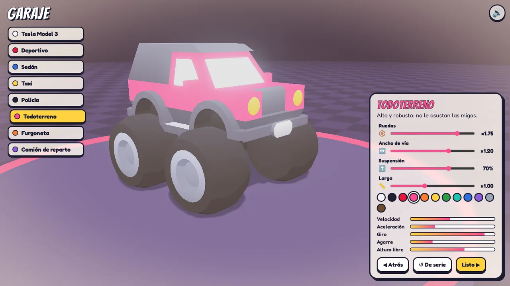
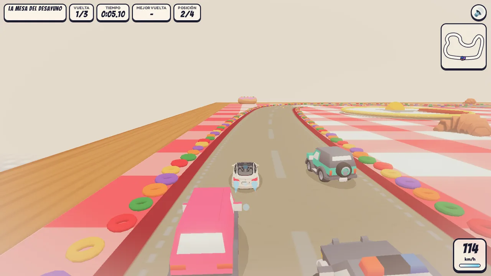
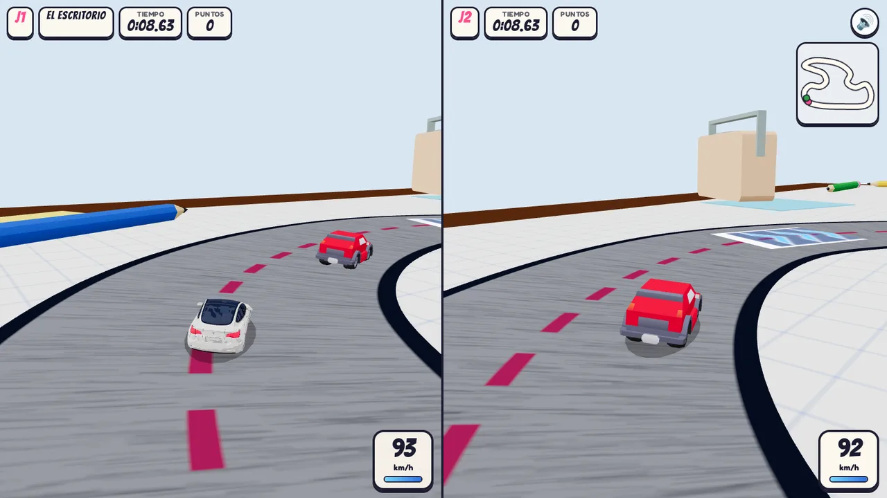
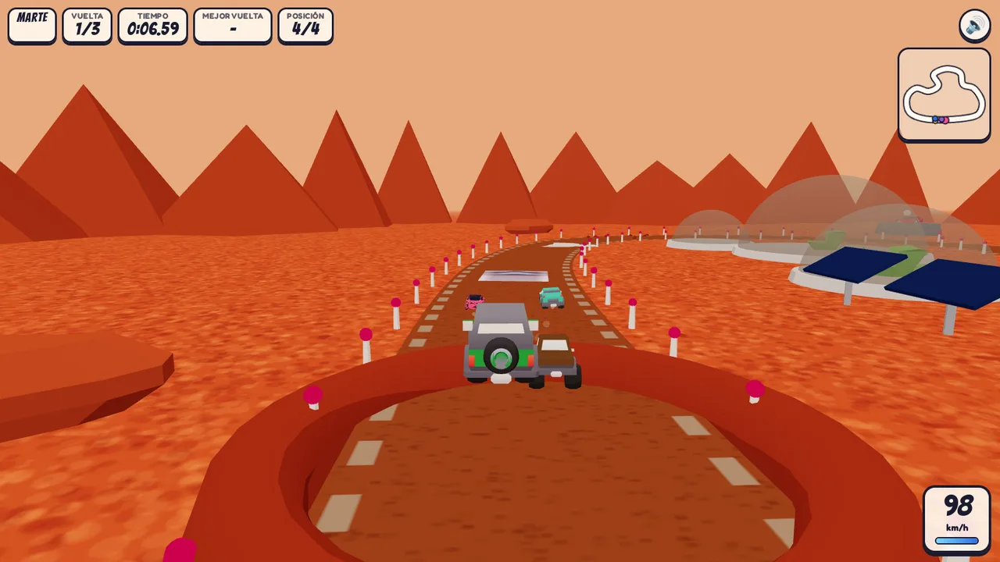
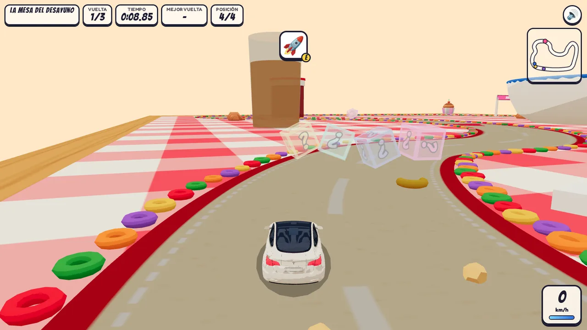
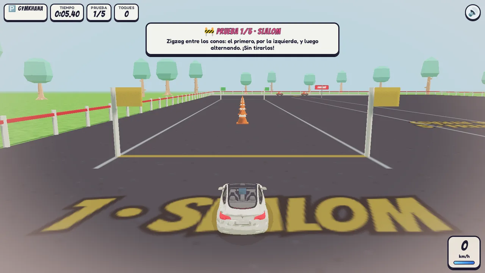

# Autoescuela Cari · a 3D driving test that ends in a marriage proposal


I built this game to propose to my partner. She sat a "driving test" at home, then finished it inside our
Tesla on the car's own touchscreen. The last question was the real one. **She said yes. 💍**

This repository is the **anonymized public version**. Names, places, photos and inside jokes have been replaced
with fictional ones, but the engine and the whole experience are the same.

**▶ Play it: [proposal.alopezs.com](https://proposal.alopezs.com)**. The game UI is in Spanish, because the quiz parodies the Spanish
DGT driving theory test.

| | |
|---|---|
|  |  |
|  |  |

## The experience

1. **Theory test, at home.** A white Model 3 drives along a road through miniature dioramas of "our story":
   a café, a mountain road with hairpin bends, a cinema, Barcelona, a road trip south, a control tower where the car
   sprouts wings, and a rocket trip to Mars. Each stop raises a 3D road sign and asks a parody DGT question with
   three answers.
2. **In the car.** The car parks at a Supercharger, and the game continues on the Tesla's browser. It asks
   questions about the car itself, then runs a **free-driving exam with a gamepad**: STOP sign, 30 km/h zone with a
   pedestrian crossing, roundabout with indicators, traffic light and parking. An examiner gives directions and
   counts faults.
3. **Commitment.** A forest road lit by lanterns, where every answer is "yes".
4. **The question.** A night drive around a heart-shaped lake, a gazebo on a cliff, a ring box that opens… and
   _¿Quieres casarte conmigo?_ Fireworks follow, then a final "inspection": a red heart-shaped box hidden under the
   TV stand in the real living room.


## Bonus: the driving mode

The gamepad exam was the part everybody wanted to replay, so it grew into a game of its own. Open it from the
**🏁 Conducir** button on the title screen, or go straight to `drive.html`. It feels a bit like Micro Machines:
toy cars racing over giant everyday things.

| | |
|---|---|
|  |  |
|  |  |
|  |  |

- **Garage.**
  - Eight cars: the Model 3 plus seven Kenney vehicles.
  - Live tuning of wheel size, track width, suspension height, length and paint.
  - The Kenney models have separate wheels, so big wheels and a lifted body produce a real monster truck.
  - Every change also feeds the physics (top speed, acceleration, grip, turning, ground clearance), shown as stat
    bars.
  - Paint is found automatically: the palette textures have baked shading, so the body is detected by clustering
    hues and those triangles are split into their own material.
- **Four circuits.**
  - **Breakfast table:** cereal-lined track, slippery jam and milk, a toast ramp, and an edge you can fall off.
  - **Desk:** a pencil-drawn track around a laptop, with ink spills and pencils as guard rails.
  - **Garden:** a dirt path, puddles and mud, a garden-hose barrier, and a snail that will not yield.
  - **Mars:** 38 % gravity, so every crater rim becomes a long jump.
- **Kart-style items in races and versus.**
  - Breaking a `?` box spins an item roulette. The odds depend on your position, so the leader gets traps and
    the last car gets the strong items.
  - The items: 🍄 boost, 🍌 banana and 🛢️ oil slick (dropped behind), 🎾 a bouncing ball that ricochets off walls,
    🚀 a homing rocket that chases the car ahead, ⭐ a star (invincible and faster) and ⚡ lightning, which shrinks
    and slows everybody else.
  - The AI uses items too: it drops traps when someone is right behind and fires when it has a clear shot.
- **Menu music:** a swung jazz-funk loop in the spirit of kart-racer menus (electric piano, slap bass, brass
  stabs, whistle lead), synthesized live like the rest of the soundtrack.
- **Modes.**
  - **Time trial:** a ghost of your best lap is stored in the browser.
  - **Race:** three AI rivals.
  - **Two-player split screen:** Micro Machines rules. Pull more than 40 m ahead, or make the other car fall off,
    and you score a point; first to 5 wins.
  - **Gymkhana:** slalom, bay parking, parallel parking, reversing into a garage and a precision stop, scored with
    stars.
  - **Driving exam:** the original exam, now with the car of your choice.
- **Under the hood.**
  - Arcade physics with lateral grip, which gives drifts, handbrake and boost.
  - Jumps under per-map gravity, and circle/box/segment collisions with a spatial grid.
  - Low obstacles split into bumps (everybody drives over them) and steps (only cars with enough clearance climb
    them).
  - Physics runs in sub-steps, so it stays stable on slow devices.
  - Menus can be navigated with the gamepad, and every car has its own shadow and skid marks.

## Engineering highlights

- **No build step.** About 16k lines of plain JavaScript in native ES modules. Three.js r160 loads through an
  import map, so any static host can serve it.
- **Data-driven procedural world.**
  - The road is generated from an itinerary (`data/places.js`). Cars drive in the right lane.
  - Mountain roads have hairpins, a summit roundabout and a separate lane for the descent.
  - There are three-lane motorways, road trips with roundabouts, tolls and traffic, and "flight" and "space"
    transitions between places.
  - Each place gets a diorama made of procedural geometry plus CC0 models. Static geometry is merged and vegetation
    is instanced to keep draw calls low.
- **Stylised rendering.**
  - Toon shading with post-processing: tilt-shift for the miniature look, bloom, and a colour grade that adapts to
    time of day and outer space.
  - A "lite" mode turns off shadows and post-processing on slow devices.
- **Camera direction.**
  - Follow, crane and travel shots, establishing shots and orbits.
  - Trees that would block the car are hidden only when they actually cover it on screen, using a screen-space
    bounding-box test.
- **Readable, touch-friendly UI.** Questions are HTML overlays anchored to 3D points, so the text stays crisp and
  tapping works reliably on the Tesla's touchscreen.
- **Gamepad driving sim.**
  - Uses the Gamepad API (Xbox or PlayStation pads) with keyboard as a fallback.
  - Arcade car physics, turn signals, speed limits and fault detection.
  - A rule-based examiner adds a harder second lap.
- **Generative audio.** Music, ambience, effects and the electric motor hum are synthesised at runtime with the
  Web Audio API.
- **In-car browser support.** The game detects the Tesla browser and offers a full-screen "theatre mode" and a
  "continue the route" entry point.
- **Graceful fallback.** Without WebGL, the game falls back to a 2D version (`classic.html`).
- **Optional password gate on Vercel.**
  - Routing Middleware plus a serverless function check the password on the server.
  - Sessions use an HMAC-SHA256-signed, HttpOnly cookie.
  - The hint UI never leaks letters. A wrong guess only tells you whether you are "close" or "half right".
- **Content tooling.** `admin.html` with `server.py` is a local editor for questions and their images.
- **Visual testing.** Headless Chrome (Puppeteer) captures screenshots of any point in the game through URL
  parameters such as `?stage=exam` or `?stage=theory&q=12`.

## Run it locally

```bash
./server.sh          # Python static server + question editor API on http://localhost:8000
```

Then open <http://localhost:8000>. Useful URL parameters:

| Parameter | What it does |
|---|---|
| `?stage=theory&q=5` | Jump to a question. Other stages: `technical`, `exam`, `commitment`, `paseo`, `last`, `proposal`, `celebration`, `glovebox` |
| `?tesla=true` | Pretend to be the car's browser |
| `?lite=1` | Lite mode (no shadows or post-processing) |
| `?debug=1` | FPS and draw-call counter |
| `?classic=1` | 2D version |
| `?fast=1`, `?timescale=0.5` | Speed animations up, or slow the camera down |
| `drive.html?mode=race&map=marte&car=suv` | Driving mode, skipping the menus. Modes: `time`, `race`, `versus`, `gymkhana`, `exam`. Maps: `desayuno`, `escritorio`, `jardin`, `marte` |
| `drive.html?…&autopilot=1` | The AI drives your car (handy for testing and as a demo) |

Exam controls: on a gamepad, **RT** accelerates, **LT** brakes or reverses, the **left stick** steers,
**LB/RB** work the indicators and **A** confirms. On a keyboard: arrow keys or **WASD**, **Q/E** for the
indicators and **Enter** to confirm.

Driving-mode controls: **RT/LT** accelerate and brake, **B** handbrake, **A** boost, **X** or **LB** use item
(hold the brake to throw it backwards), **Y** back to the track and **Start** pause. On a keyboard: **WASD** or the
arrow keys, **Space** handbrake, **Shift** boost, **E** item, **R** back to the track and **Esc** pause. In two-player mode each player has their own gamepad, or their own half of the keyboard
(WASD and **E** for player 1, the arrow keys and **.** for player 2).

## Deploy

The site is fully static, so it runs on any static host. The public demo runs on GitHub Pages. On Vercel you also
get the optional password gate:

| Env var | |
|---|---|
| `GAME_PASSWORD` | When set, a password is required before playing. When unset, the site is public. |
| `SESSION_SECRET` | A long random string used to sign the session cookie. |

The login hints live at the top of `login.html`.

## Make your own

Everything personal sits in a handful of data files: places, questions, texts, the couple's initials and the
characters. See [CUSTOMIZE.md](CUSTOMIZE.md).

```
index.html            3D game (Three.js)       classic.html   2D fallback
game/                 engine, world, track, dioramas, camera, exam, finale, UI
drive.html, game/drive/   driving mode: cars & tuning, vehicle physics, circuits, AI, ghost, modes, menus
data/places.js        the itinerary (one diorama per place)
questions.json        theory questions          data/practical-questions.js   in-car questions
sfx.js                generative music and sound effects
middleware.js, api/   optional password gate (Vercel)
admin.html, server.py local question editor
```

## Credits

- Low-poly models by [Kenney](https://kenney.nl) (CC0).
- Tesla model: ["Tesla White car."](https://sketchfab.com/3d-models/tesla-white-car-2a4ee44439dc4b1b98f452a9ff427116)
  by [aarajesh](https://sketchfab.com/aarajesh), licensed under
  [CC BY 4.0](http://creativecommons.org/licenses/by/4.0/). Optimised and lightly modified (headlights).
- Question illustrations generated with Google Gemini.
- [three.js](https://threejs.org), [canvas-confetti](https://github.com/catdad/canvas-confetti), and Google Fonts
  (Bangers, Fredoka, Caveat, Playfair Display).
- Built with [Claude Code](https://claude.com/claude-code) as an AI pair programmer.

---

Code © 2026 Alberto López Sánchez, [MIT licensed](LICENSE). Third-party assets keep their own licenses (see
Credits) · [cv.alopezs.com](https://cv.alopezs.com)
